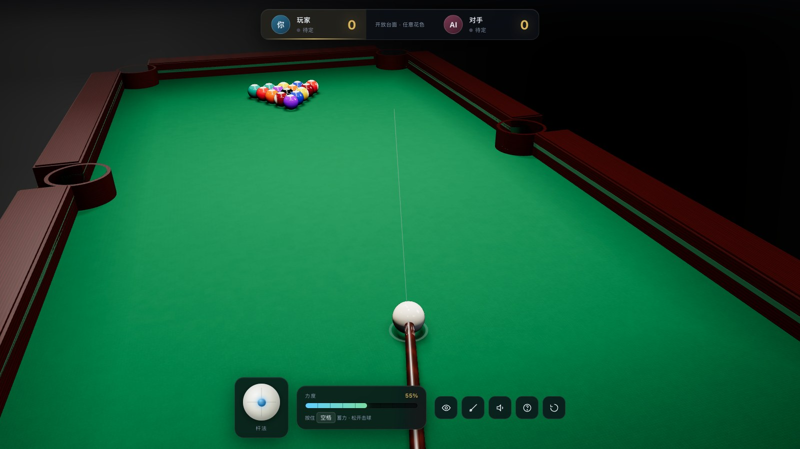

# zhizhen-pool · 桌面台球 黑八

一个以 **DSH Web UI 插件** 形式发行的三维美式 8 球台球桌：从任意会话的输入框左侧点「台球」进入全屏球台；点右上角「返回会话」或按 `⌥P` 回到对话。



## 玩法

- **9ft 比赛台**：2.54 × 1.27 m 标准台面、Ø57.15 mm 用球、六袋口按真实尺寸建模
- **真实杆法**：低杆回拉、高杆跟进、左右塞吃库变线——都是三段式摩擦模型算出来的，不是预先写死的动画
- **WPA 规则**：开球、分组（全色 1-7 / 花色 9-15）、犯规判定、手中球、8 号球胜负
- **AI 对手**：枚举「目标球 × 袋口」的可行击球并评分，带难度误差，会做走位
- **全程序化音效**：撞球、吃库、落袋、皮头、犯规、胜负全部用 Web Audio 实时合成，没有任何音频文件
- **胜利礼花**：打进 8 号时满屏礼花与奖杯

## 操作

| 操作 | 说明 |
| --- | --- |
| 在台面上按住拖动 | 旋转瞄准（可转到任意角度） |
| 按住 `Space` | 蓄力，松开击球 |
| 单击台面 | 以当前力度直接击球 |
| 滚轮 | 微调力度 |
| `←` `→` / `A` `D` | 瞄准粗调 0.10° |
| `Shift` + `←` `→` | 瞄准细调 0.01° |
| `,` `.` | 超精调 0.001° |
| 拖动左下角白球 | 杆法（高杆 / 低杆 / 左右塞） |
| 点击台面 | 摆放母球（手中球时） |
| `T` / 右键 | 切换俯视视角 |
| `G` | 辅助线开关 |
| `R` | 重开一局 |
| `F` / `Esc` | 规则与操作说明 |
| `⌥P` | 在会话里随时打开 / 收起球台 |

## 安装

市场收录后可在 **设置 → 插件 → 插件市场** 搜索 `zhizhen-pool` 一键安装；也可以从源码装：

```sh
dsh plugin --profile <profile> add github:lizzkkafei/my-projects#path:/desktop-pool-plugin
```

装完刷新 DSH 页面（⌘R）即可在会话输入框左侧看到「台球」按钮。

## 实现

- 单文件 Client bundle（`client.js`，由 `scripts/build.mjs` 生成），通过
  `conversation.input.left` 注册入口、`shell.overlay` 注册全屏球台
- 游戏本体跑在 **shadow root** 里：样式和元素 id 不会污染 DSH 界面
- 关闭覆盖层时会回收：所有 `requestAnimationFrame`、窗口监听器、`AudioContext`
- 物理常数取自 `pooltool` 与 `tailuge/billiards` 的实测值（Han 2005 / Mathavan 2007 碰撞模型）

## 自检

```sh
node scripts/check.mjs                 # 包结构检查（插件管理器与市场 CI 看的东西）
cd game && node selftest.mjs           # 26 项物理/规则断言
cd game && node gametest.mjs 10        # 10 局 AI 自动对战
```
