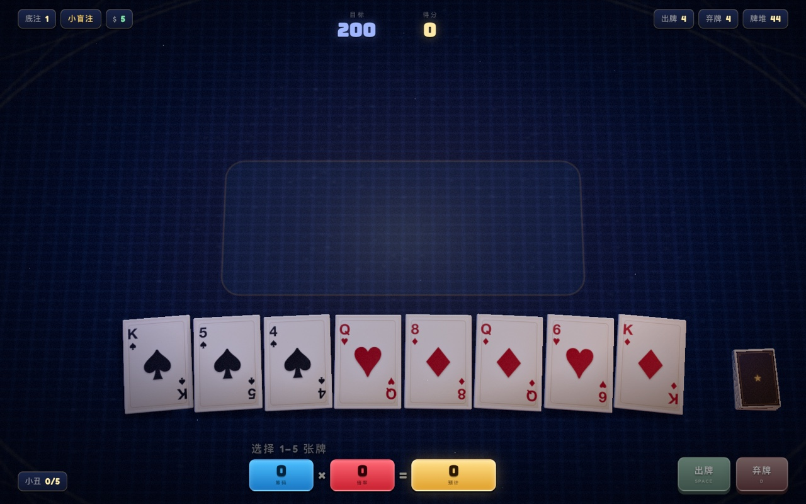

# zhizhen-cardgame · 小丑之桌 JESTER'S TABLE

一个可直接在浏览器里玩的三维扑克 Roguelike：以「小丑牌」改写着牌的五张牌计分，用 **筹码 × 倍率** 一层层推高底注，撑过 6 层底注就算通关。



## 玩法

- 每关从 8 张手牌里选 1–5 张打出，按牌型结算 **筹码 × 倍率**
- 12 种牌型：高牌、一对、两对、三条、顺子、同花、葫芦、四条、同花顺、五条、同花葫芦、同花五条
- 每关 4 次出牌、4 次弃牌；目标分数随底注升高（200 → 500 → 1200 → 2800 → 6000 → 12000）
- 小 / 大 / BOSS 三种盲注，BOSS 盲注附带 6 种干扰效果之一（钩子、高墙、针、死水、头颅、嘴）
- 商店：买小丑、卖小丑、花钱换一批；每关首 3 个小丑槽位，手上最多带 5 张
- 金钱有 5% 利息（上限 $5），攒钱也是一种策略
- 20 种小丑牌，结算时从左到右逐个生效

## 实现

- Three.js 实时 3D 牌桌：发牌、出牌、翻牌、结算飞字与辉光后期，全部由代码生成，无外部贴图
- 牌型判定与计分是纯逻辑（`js/rules.js`），与渲染分离
- WebAudio 程序化合成音效，不需要音频文件
- 纯静态文件，无构建步骤、无网络依赖（Three.js 与字体均已本地化）

## 运行

需要 ES module + importmap，所以要走本地 HTTP 服务（直接双击 `index.html` 不行）。

macOS 双击 `启动游戏.command`：自动找空闲端口、起静态服务器并打开浏览器。

或者手动：

```bash
cd zhizhen-cardgame
python3 -m http.server 8899
# 浏览器打开 http://localhost:8899/index.html
```

## 操作

| 操作 | 说明 |
| --- | --- |
| 点击牌面 | 选牌 / 取消选牌（1–5 张） |
| `SPACE` / 出牌 | 打出已选牌 |
| `D` / 弃牌 | 弃掉已选牌 |

## 目录

```
index.html            页面骨架、HUD 与 importmap
preview.jpg           游戏截图
css/style.css         界面样式
js/main.js            游戏流程、交互、动画编排、商店
js/rules.js           牌型判定与计分（纯逻辑）
js/cards.js           牌堆构建与洗牌
js/jokers.js          20 种小丑牌定义与效果
js/table.js           Three.js 3D 牌桌与动画
js/audio.js           WebAudio 程序化音效
vendor/               Three.js r1xx（module 版与 addons）
fonts/                Bungee / Fredoka 字体
启动游戏.command       macOS 本地启动器
```

想调难度就改 `js/main.js` 顶部的 `CONFIG`（底注分数、出牌/弃牌次数、小丑槽位等）。

## 许可

MIT，见仓库根目录 [`LICENSE`](../LICENSE)。
