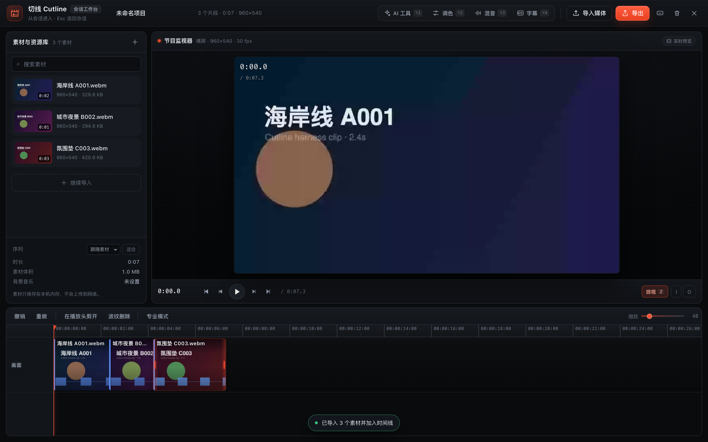
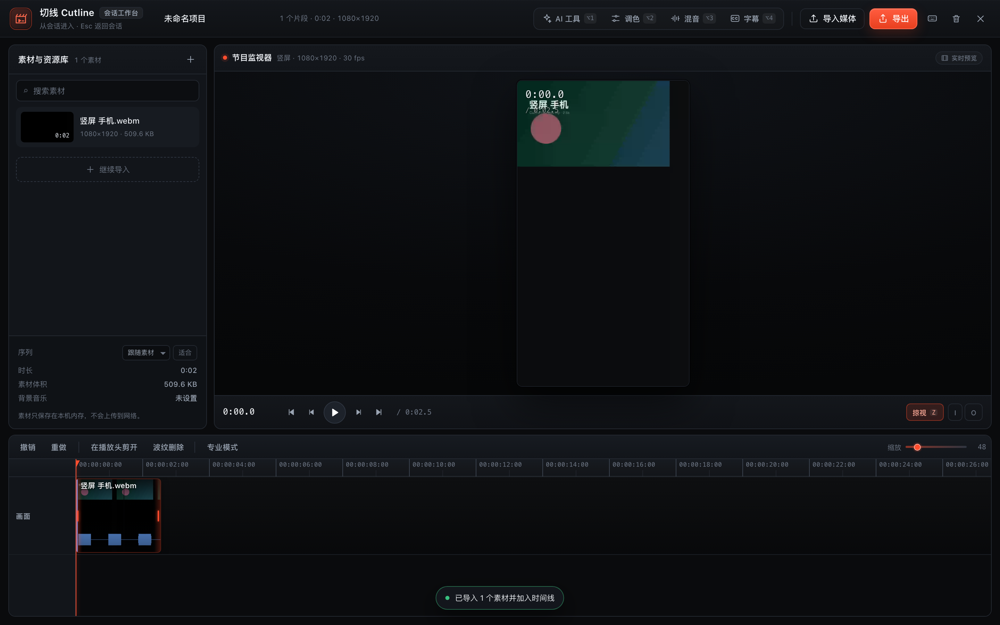
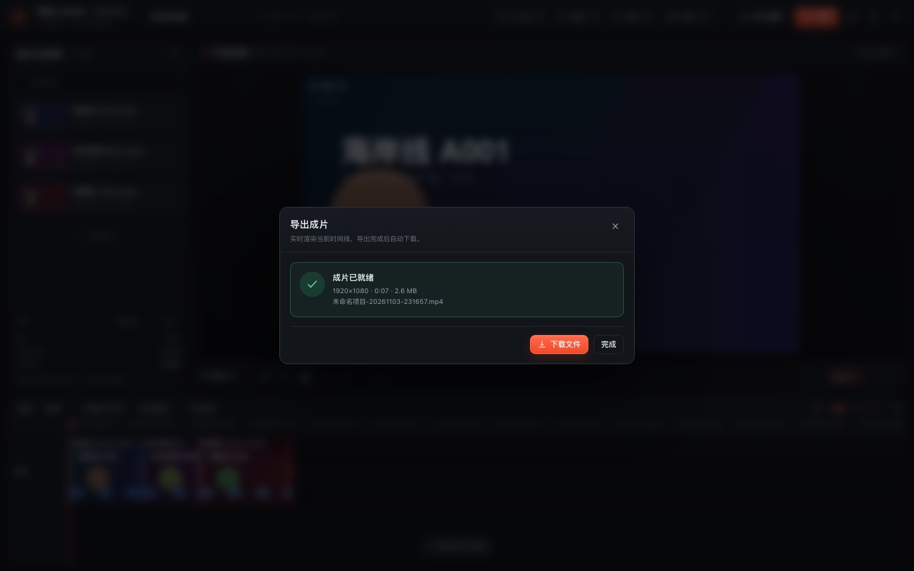
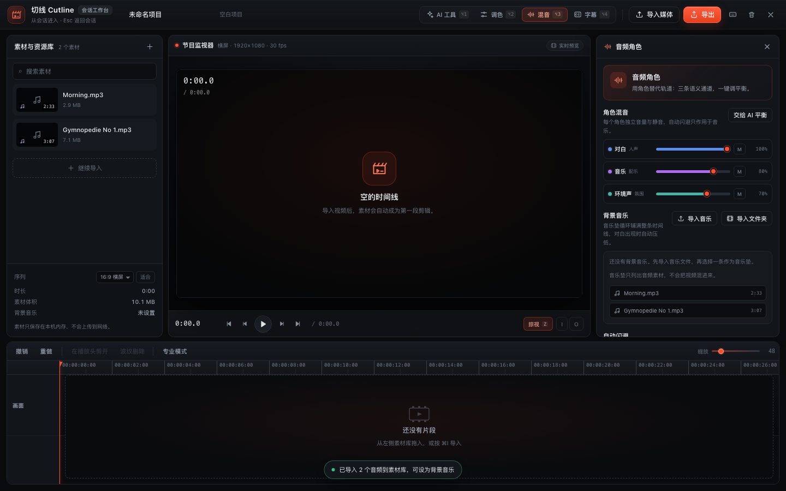

# 切线 Cutline · 会话内的视频编辑工作台

一个以 **DSH Web UI 插件** 形式实现的单窗口视频剪辑工作台：从任意会话的输入框左侧点「剪辑」进入，剪完按 `Esc` 回到对话。

竖屏素材会建立 9:16 序列并按竖屏画幅预览：

## 入口

- **会话输入框左侧的「剪辑」按钮**（带当前片段数角标）。
- 任意位置按 **⌥C** 打开；打开后 **Esc** 逐层退出（面板 → 工作台）。
- 插件已安装到 `desktop` profile：`zhizhen-cut`。

> 若刚更新过插件代码，请刷新页面（⌘R）以载入最新 client bundle；仍未更新时重启 DSH。

## 已实现的能力

### 导入与媒体

- **自动识别画幅**：首段视频的宽高决定序列格式，竖屏手机会建立 `1080×1920` 竖屏序列，预览、导出、时间线缩略图全部按竖屏画幅显示（不再挤在横屏框里裁切）。
- 素材库底部提供**序列格式**下拉（跟随素材 / 16:9 横屏 / 9:16 竖屏 / 1:1 方形）和**画面适配**切换（适合=完整显示留黑边，填充=铺满裁切）；中途换序列也不会出现画面拉伸。

- 一次选择/拖入多个视频或音频文件（MP4 / MOV / WebM / MP3 / WAV 等），自动生成缩略图与音频峰值。
- 视频导入后自动铺到磁吸时间线，也可从素材卡片拖到任意位置；**音频导入只进入素材库**，不会自动变成时间线片段，方便直接当背景音乐。
- 音频面板支持「导入音乐」和「导入文件夹」，可以一次把整个本地音乐目录批量导入。
- 素材只保存在当前浏览器标签页内存中，不上传网络。

### 磁吸时间线

- 单条主轨、片段首尾相接、无空隙；删除/修剪后自动前移。
- 拖动片段重排（带插入指示线）、拖动左右边缘修剪入出点、双击跳到片段头。
- 播放头剪开（B / ⌘B）、波纹删除（Delete）、撤销/重做（⌘Z / ⇧⌘Z）。
- 鼠标掠过时间线即时预览（Skimming，Z 开关），带掠视时间提示。
- 触控板：双指横滚平移、Ctrl/⌘+滚轮（捏合）以光标为中心缩放。
- **专业模式**：时间线右上角开关，展开 V 主轨 + 对白/音乐/环境声三条角色泳道 + 字幕泳道，显示选中片段的逐帧时间码。

### 声音

- 用**音频角色**替代轨道：对白 / 音乐 / 环境声，各自独立音量与静音。
- 背景音乐垫：只列出音频素材（不会再出现导入的视频），可循环铺底。
- **自动闪避（Ducking）**：对白出现时音乐自动压低，对白结束恢复；预览与导出同时生效。

### AI 工具（本地处理，不上传）

- 三个能力都能在真实带音轨的视频上工作：
  - 若浏览器无法用 `decodeAudioData` 解出音轨（部分 MP4/MOV/AAC），会**自动回退到媒体元素加速播放 + AnalyserNode 提取能量**，再做粗剪；不需要上传服务器。
  - 粗剪会显示删掉的静音秒数，结果可撤销。
  - 9 种调色预设会实际改变预览与导出像素（已用逐像素测试验证）；默认作用于整条时间线，也可切换为仅选中片段。
- **智能粗剪**：分析音频能量，按阈值/最短停顿切掉静音与呼吸空白，磁吸重排；支持从视频音轨提取峰值。
- **脚本字幕**：粘贴解说词，按句子均匀铺到时间线，生成可编辑字幕轨，实时烧录预览。
- **智能调色**：9 种风格 LUT（原片/电影/暖调/冷调/黑白/浓彩/褪色/夜景/复古），默认整条时间线、可切到单个片段；预览与导出使用同一套 canvas filter。
- **角色分轨**：选中片段一键归入对白/音乐/环境声，作为人声分离的等价工作流。
- 说明：人声分离模型与超分辨率/稳定模型未随本版分发，界面中已如实标注；不做假进度或假结果。

### 导出

- 实时渲染整条时间线（或入点→出点范围），`canvas.captureStream` + WebAudio 混音 + `MediaRecorder`。
- 分辨率：原尺寸 / 1080p / 720p / 4K；帧率 24/30/60；可烧录字幕、包含背景音乐。
- **默认输出 MP4（H.264 + AAC，.mp4）**，QuickTime、iOS/Android、Windows 和主流平台可直接播放；导出面板会明确显示输出格式。
- 只有当前浏览器不支持 MP4 录制时才回退为 WebM（VP9/VP8 + Opus），并在面板中提示原因；建议用 Chrome 或 Safari 获得 MP4。
- 完成后可直接下载。
- 导出期间请保持标签页在前台；实时导出耗时约等于片长。
- 实测导出文件：`ISO Media, MP4 Base Media v1`，视频轨 **H.264 (avc1) 1920×1080**，音频轨 **AAC**，时长 7.5s，QuickTime/AVFoundation 可正常读取。

## 本地背景音乐库

工作区根目录的 [`music-library/`](../music-library/README.md) 里保存了 10 首不同风格的本地 MP3（晨间 / 古典 / 氛围 / 电子 / 电影感 / 暗黑 / 爵士 / 蓝调 / 轻快 / 拉丁），来自 [Incompetech](https://incompetech.com/music/royalty-free/music.html)（Kevin MacLeod），许可为 **CC BY 4.0**：可商用，但发布时需要在简介或片尾署名。

在音频面板点「导入音乐」选择单曲，或点「导入文件夹」直接选中整个 `music-library/` 目录批量导入；署名模板和曲目清单见该目录的 [README.md](../music-library/README.md)。

## 快捷键

| 键 | 动作 |
|---|---|
| Space | 播放 / 暂停 |
| J / K / L | 倒放 / 停 / 快进（连按加速） |
| ← / → | 逐帧（Shift 10 帧） |
| I / O | 设置入点 / 出点 |
| B / ⌘B | 在播放头剪开 |
| Delete | 波纹删除选中片段 |
| ⌘Z / ⇧⌘Z | 撤销 / 重做 |
| Z | 掠视开关 |
| N | 吸附开关 |
| P | 专业模式 |
| + / − | 时间线缩放 |
| ⌥1 / ⌥2 / ⌥3 / ⌥4 | AI / 调色 / 混音 / 字幕面板 |
| ⌘I / ⌘E | 导入 / 导出 |
| Esc | 收起面板 / 返回会话 |
| ? | 快捷键帮助 |

## 技术结构

- 单文件 Client bundle（`client.js`，由 `scripts/build.mjs` 从 `src/` 生成），通过 `conversation.input.left` 注册入口、`shell.overlay` 注册全屏工作台。
- `src/engine.js`：纯函数时间线核心（磁吸、修剪、分割、角色增益、静音检测、字幕排布）。47 个 node:test 单测。
- `src/media.js`：媒体导入、Canvas 预览、WebAudio 闪避、实时导出。
- `src/timeline.js` + `src/timeline.css`：磁吸时间线 React 组件。
- `src/core.js` / `src/panels.js` / `src/workbench.js` / `src/ui.js` / `src/entry.js`：外壳、隐藏面板、导出/快捷键弹窗、Cordis 注册。
- 素材与工程状态仅存在于当前标签页内存；关闭会话/刷新后不保留。

## 验证状态

- `node scripts/build.mjs`：bundle 构建 + `node --check` 通过。
- `node scripts/smoke.mjs`：真实 bundle 在 VM 中注册两个 slot、安装样式、注册词典。
- `node scripts/render-smoke.mjs`：入口按钮 → 打开工作台 → 递归渲染工作台组件树，无异常。
- `node scripts/timeline-smoke.mjs`：空工程 / 有片段 / 字幕 / 专业模式的时间线渲染，无异常。
- `node --test tests/engine.test.mjs`：47/47 通过。
- 本地 Playwright + 真实 React 19 harness（非 DSH 页面）端到端：入口 → 导入 3 个**带真实 Opus 音轨**的视频 → 预览取帧 → 播放 → 键盘逐帧 → 分割（3→4 段）→ 脚本生成 3 条字幕 → 专业模式 3 条角色泳道 → 导出 1920×1080 WebM（约 3.9 MB）→ Esc 返回会话；0 页面错误、0 console error。
- 竖屏测试：导入 1080×1920 带音轨视频，序列显示 `竖屏 · 1080×1920`，预览画幅比例 0.563，导出为 `1080×1920`；切到 16:9 序列后预览变为 1.778，再切「填充/适合」均正常。
- AI 测试：真实音轨上粗剪切掉约 0.8–2.9 秒静音并把片段数从 3 增加到 9；9 个风格预设逐个切换，预览像素均发生对应变化；缺少峰值时 `analyzeAssetAudio` 回退提取到 800 点峰值。
- 音乐库测试：真实导入 `music-library/calm/Morning.mp3` 后时间线 **0 个片段**（音频不自动进时间线），素材库显示 2:33；音频面板背景音乐候选只出现音频；点击后成功设为音乐垫并显示「循环铺底 · 2:33」。
- 批量导入测试：用「导入文件夹」选中 `music-library/calm/`，一次导入 2 首 MP3，候选区只列出这两首，时间线仍为 0 片段，0 错误。
- **DSH 页面内验证**：插件已安装，`conversation.input.left` 与 `shell.overlay` 两个 slot 的注册均为 `active`；但受本机 Web GUI 登录态限制，无法从自动化侧截图确认最终宿主页面外观，需要刷新页面后人工确认。
