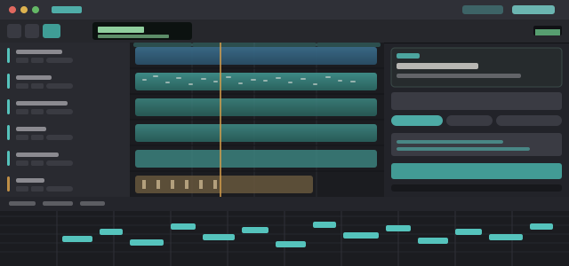

# 理音 Liyin Studio

从 DSH 会话进入的 AI 音乐创作工作台。写词、编曲、录音、混音、导出母带，都在同一个窗口里完成。



- **入口**：任意会话输入框左侧的「理音」按钮，或按 **⌥M**（⌥L 亦可）。**Esc** 收起回到对话。
- **风格**：Logic Pro 式深色界面，中文优先。
- **自带示例**：打开即是《镜湖》工程——72 BPM / A 小调 / 68 小节，含歌词、和弦、旋律 MIDI 与 4 条 AI 生成音频，开箱即可试听、编辑、导出。

---

## 快速开始

### 安装

```sh
dsh plugin --profile <profile> add github:lizzkkafei/my-projects#path:/zhizhen-liyin
```

`<profile>` 换成你的 profile 名（通常是 `desktop` 或 `web`）。

新增插件属于 **host 半更新**，需要重启一次 DSH 才会出现入口。重启后打开任意会话，输入框左侧应出现「理音」按钮。

> 若按钮未出现，先硬刷新页面（⌘⇧R）；仍无则确认 profile 改动已保存后重启。

### 卸载

```sh
dsh plugin --profile <profile> remove zhizhen-liyin
```

---

## 功能

### 编排与时间线

- 多轨音频 / MIDI / 鼓机轨，轨道头含色彩标记、静音（M）、独奏（S）、音量滑杆
- 片段拖动改位置，双击 MIDI 片段打开钢琴卷帘、双击鼓机片段打开步进音序
- 段落标记（前奏 / 主歌 / 预副歌 / 副歌 / 间奏 / 桥段 / 尾声）铺在小节标尺上
- 撤销 / 重做（⌘Z / ⇧⌘Z），编辑自动保存到浏览器本地
- 缩放滑杆调整小节宽度；播放时播放头跟随滚动

### 走带

播放 / 暂停（空格）、停止（回车）、回到开头、倒回一小节、循环播放、节拍器、预备拍、跟随播放。

LCD 显示「小节 · 拍 · 十六分 · 拍号」与时间码，附带速度、调性、拍号。

### 钢琴卷帘

- 点击加音符、拖动移位、双击删除
- 1/16 量化、力度调节、选中删除
- 点击音符即时试听

### 步进音序器

16 步 × 4 行（底鼓 / 军鼓 / 踩镲 / 开镲），三套鼓组（Studio / Brush / Tape），小节试听，可清空。编辑结果写入鼓机轨的片段。

### 五线谱

Canvas 绘制的大谱表（零依赖，`notation.js`）：

- 高音 / 低音谱号、调号、拍号、加线、符干方向、附点、符尾
- 按拍分组的符杠（十六分音符双杠）
- 和弦符号与段落标记对齐小节，每行按密度自适应 4 或 8 小节
- 三种视图：**旋律** / **钢琴**（高低声部拆两条谱表）/ **全部**
- 播放时高亮当前小节并自动滚动到所在行
- 一键**导出 PNG**

### 录音与多 take 合成

- 立体声录音，录完自动写入「主唱」轨
- 多 take 列表：逐条权重滑杆（0–100%）、独听（S）、自动对齐起点
- 「合成为一条」按权重归一化混合，带 tanh 软限幅防削波

### 混音

- 通道条：推子、声像、静音 / 独奏、两路发送（混响 / 延迟）
- 立体声主表，实时电平显示
- 「智能混音建议」按乐器角色分配增益 / 声像 / 发送；「重置推子」恢复默认

### 自动化曲线

每条轨道的 **音量 / 声像 / 混响 / 延迟** 四条曲线：

- 空白处点击加点、拖动控制点、双击删除
- 内置形状：**淡入淡出**、**副歌渐强**（按段落自动生成）
- 播放时实时写入音频参数；**离线渲染同样生效**，导出的母带带自动化

### 智能辅助

右侧面板，两条路径并存：

1. **本地演算器**（离线可用）
   - 「生成歌词」：按主题关键词与风格生成主歌 / 预副歌 / 副歌 / 桥段结构
   - 「生成编曲」：按风格生成和弦走向、钢琴琶音、贝斯、铺底、旋律与鼓组，直接写入工程
   - 三个滑杆真实影响结果：**贴合原意**、**创意开放**、**编曲密度**
   - 五种风格：氛围民谣 / 后摇 / 电子 / 弦乐四重奏 / 中国风

2. **ACE-Step 本地模型**（需另装模型服务）
   - 「调用模型生成整首歌」：走 `/api/liyin/ace/*` 反向代理到本机 ACE-Step 1.5
   - 生成结果自动进「主唱」轨，生成期间可继续编辑
   - 模型服务未启动时其余功能不受影响，面板会提示未连接

### 导出

| 导出内容 | 说明 |
|---|---|
| 立体声混音（母带 WAV） | 离线渲染整首或指定范围 |
| 分轨 ZIP | 每轨独立 WAV 打包，含分轨说明文本 |
| 仅主唱干声 | 单独导出主唱轨 |
| 伴奏（除主唱） | 其余轨道混音 |
| 工程 JSON | 完整工程数据，可备份或迁移 |

响度规范（ITU-R BS.1770 简化实现 + −1 dBFS 峰值保护）：

- 保持原始电平
- **−14 LUFS** 流媒体（Spotify / Apple Music）
- **−16 LUFS** 播客 / 有声
- **−9 LUFS** 响母带

导出后状态栏显示归一化前后的 LUFS 与增益值。

### 能力地图

顶栏「能力地图」可在应用内查看 MVP / V1 / 后续三期拆解，以及当前覆盖状态（✓ 已覆盖 / ◐ 部分覆盖 / ○ 规划中）。

---

## 快捷键

| 键 | 动作 |
|---|---|
| 空格 | 播放 / 暂停 |
| 回车 | 停止 |
| ⌘Z / ⇧⌘Z | 撤销 / 重做 |
| ⌘S | 保存工程 |
| R | 打开录音 |
| ⌥M / ⌥L | 在 DSH 会话中打开 / 收起工作台 |
| Esc | 收起工作台回到会话 |

---

## 模型服务（可选）

「调用模型生成整首歌」需要本机运行 ACE-Step 1.5 API。这不是本插件的依赖，其余功能不装也能用。

```sh
cd ACE-Step-1.5
export PATH="$PWD/.bin:$PATH" \
       ACESTEP_LM_BACKEND=mlx \
       ACESTEP_INIT_LLM=true \
       HF_HOME="$PWD/.hf" \
       HF_MODULES_CACHE="$PWD/.hf/modules"
.venv/bin/acestep-api --host 127.0.0.1 --port 8001 \
  --lm-model-path acestep-5Hz-lm-0.6B --download-source modelscope
```

模型权重约 7.3 GB（`acestep-v15-turbo` 2B DiT + `acestep-5Hz-lm-0.6B` 语言模型）。M4 / 16GB 上单曲约 3–4 分钟。

上游地址可用环境变量覆盖：

| 变量 | 默认 | 作用 |
|---|---|---|
| `LIYIN_WEB_DIR` | 包内 `web/` | 工作台静态目录 |
| `LIYIN_ACE_UPSTREAM` | `http://127.0.0.1:8001` | ACE-Step 上游地址 |

---

## 工作原理

插件由两半组成：

**Host 半（`index.js`）**

- 把工作台静态文件挂在 `/api/liyin/*`，与 DSH GUI **同源** —— iframe 里的音频播放、麦克风录音、素材加载都不受跨域限制
- 把 `/api/liyin/ace/*` 反向代理到本机 ACE-Step
- 拦截路径穿越（`../`）并返回 404

**Client 半（`src/entry.js` → `client.js`）**

- 在 `conversation.input.left` 注册「理音」入口按钮
- 在 `shell.overlay` 注册全屏 overlay，内嵌同源 iframe
- 注册 zh / en 词典与 ⌥M 快捷键

工作台本体是 `web/` 下的零依赖原生 Web 应用（约 6400 行）：`engine.js` 是 Web Audio 引擎，`app.js` 是界面与状态，`notation.js` 是五线谱渲染，`ai.js` 是智能辅助客户端。

### 目录

```
zhizhen-liyin/
├── index.js              Host 半：静态托管 + ACE 代理
├── client.js             构建产物（勿手改）
├── src/entry.js          Client 半源码
├── src/styles.css        入口与 overlay 样式
├── cordis.patch.yml      插件插入声明
├── package.json          清单（含 dsh.bundle / dsh.client）
├── locale/{en,zh}.json   插件市场显示元数据
├── docs/                 详情页文档与预览图
├── icon.svg              插件图标
├── scripts/
│   ├── build.mjs         生成 client.js
│   ├── test-host.mjs     Host 路由自检
│   ├── test-client.mjs   Client 注册自检
│   └── dev-server.mjs    本地调试用独立服务
└── web/                  工作台本体
    ├── index.html
    ├── styles.css
    ├── data.js           默认工程（镜湖）
    ├── engine.js         Web Audio 引擎
    ├── app.js            界面与状态
    ├── notation.js       五线谱
    ├── ai.js             智能辅助
    ├── serve.py          独立运行时的本地服务
    └── assets/audio/     4 条示例音频（约 21 MB）
```

---

## 开发

```sh
# 改完 src/entry.js 后重建
node scripts/build.mjs

# 自检
node scripts/test-host.mjs      # 静态托管 / 路径穿越 / ACE 代理
node scripts/test-client.mjs    # 模块加载 / 两个 slot 注册

# 不装进 DSH，单独跑一个服务看工作台
node scripts/dev-server.mjs     # → http://127.0.0.1:8099/api/liyin/index.html
```

工作台本体也可以脱离插件独立运行：

```sh
cd web
python3 serve.py                # → http://127.0.0.1:8090/
```

> 直接双击 `web/index.html` 也能编曲、播放、混音、导出，但素材加载与录音需要 http 环境。

---

## 已知限制

- **音源是 Web Audio 合成音色**，不是采样库。听感与商业 DAW 有差距，但工程结构、编辑逻辑、渲染与导出链路是真实的。
- **浏览器内不能挂 AU / VST 插件**。能力地图里「插件生态」标为规划中，没有做假实现。
- **ACE-Step 对 BPM / 调性是软约束**，生成结果的实际速度与调性可能有偏差；中文人声的咬字是合成音，个别字不够清晰。
- **五线谱不做小节内避让**，靠自适应每行小节数缓解；无连音线、力度记号、歌词；临时升降号不做同小节还原管理。
- **多 take 合成是对齐后加权平均**，不是基于音高 / 节奏对齐的智能拼接。
- **工程保存在浏览器 localStorage**，清缓存会丢本地状态。请用「导出工程 JSON」备份。
- **录音需要麦克风授权**；无麦克风时只能使用已有素材。
- 示例音频由 ACE-Step 生成，仅供演示工程用；正式发布作品请替换为你自己的素材。

---

## 技术说明

| 项 | 值 |
|---|---|
| 采样率 | 48 kHz / 16 bit |
| 响度测量 | ITU-R BS.1770 简化实现（K 加权 + 400ms 重叠块 + 相对门限） |
| 峰值保护 | −1 dBFS |
| 合成音色 | 加法 / 减法合成（钢琴、贝斯、铺底、旋律、鼓） |
| 混响 | 卷积（程序生成脉冲响应） |
| 总线 | 压缩器 + 立体声分析器 |
| 依赖 | 无第三方运行时依赖 |

---

## 许可

MIT。示例音频由 ACE-Step 1.5 生成，遵循其模型许可；发布正式作品前请确认你拥有所用素材的权利。
